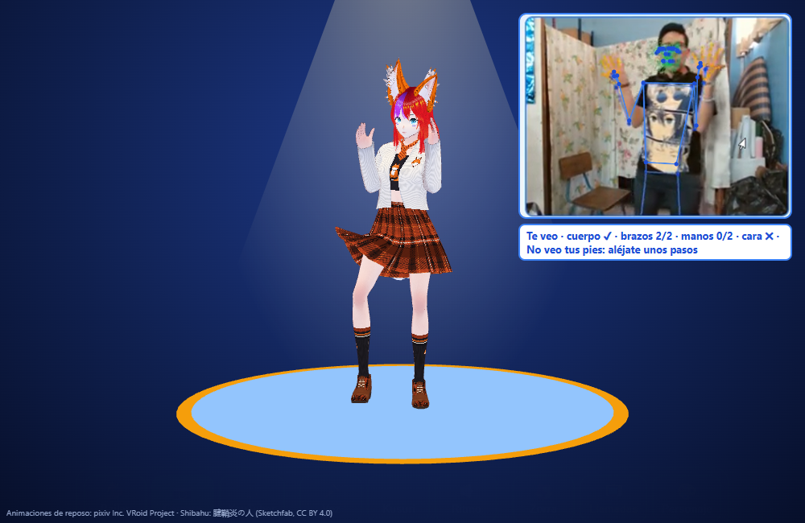
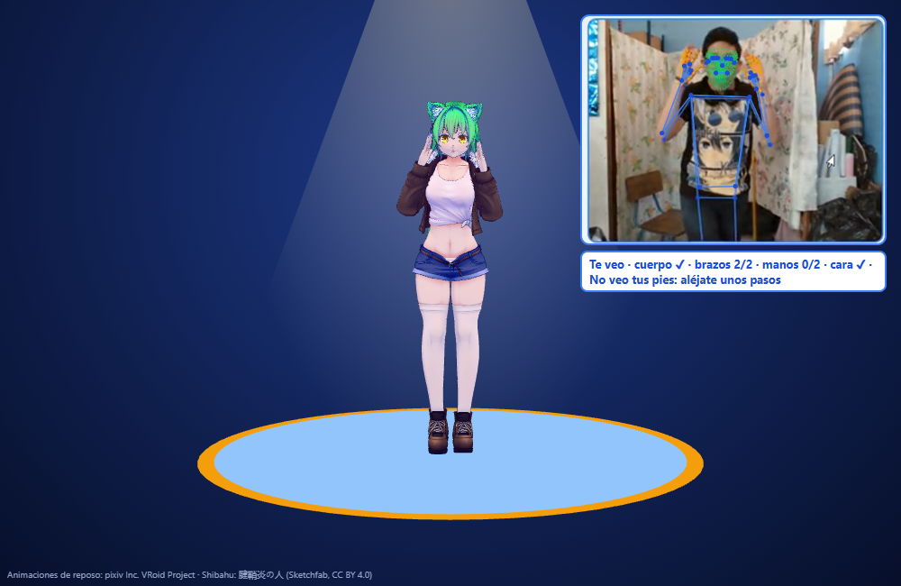

**[⬇ Descargar instalador para Windows (Personajes 3D 1.1.0)](https://github.com/nasa-cell/PEROSONAJES-3D/releases/latest/download/Instalar.Personajes.3D.1.1.0.exe)**

# Personajes 3D

Un personaje 3D (VRM) que **baila solo** o **copia tus movimientos con la cámara**: cuerpo, manos, dedos, cara, parpadeos, boca y emociones. Es una aplicación para Windows.

| Shibahu | Zorra |
|---|---|
|  |  |

## Probar

- **En Windows:** descarga el instalador en [Versiones](https://github.com/nasa-cell/PEROSONAJES-3D/releases/latest) y ábrelo. No necesita internet salvo para la voz.

## Qué hace

- 💃 **Bailar:** baile calculado al ritmo (sin música con derechos).
- 📷 **Cámara:** copia cuerpo, brazos, piernas, manos y dedos; se arrodilla, gatea y salta. Sigue a **una sola persona** aunque haya más en la cámara.
- 🙂 **Cara:** parpadeo de cada ojo, boca al hablar y emociones (feliz, enojo, tristeza, sorpresa).
- 🎥 **YouTuber:** vista de cerca, de la cintura para arriba.
- 🦊 **Zorra:** cambia entre Shibahu y la Zorra.
- 🎨 **Personaje:** tamaño del cuerpo, colores, orejas y conjuntos de ropa (Shibahu trae 4).
- Solo en la aplicación para PC: subir tus propios personajes `.vrm`, usarlo en llamadas (Meet, Zoom) con OBS y la voz Kusuri.

## Cómo está ordenado

```
pagina/        lo que se ve: index.html, programa.js, librerías, modelos de detección, ropa y personajes incluidos
servidor/      servidor.js (atiende la página), personajes.js (lista de personajes), llamadas.js (OBS y voz, solo PC), abrir.js (ventana de la app)
aplicacion/    lanzador e instalador de Windows (compilar.sh)
capturas/      imágenes de este README
```

## Usarlo desde el código

Necesitas [Node.js](https://nodejs.org) 18 o más nuevo.

```
node servidor/servidor.js
```

y abre http://localhost:8105 (en Windows también sirve `iniciar.cmd`). Para armar el instalador: `sh aplicacion/compilar.sh` (con `PUBLICO=1` arma la versión para compartir).

## Créditos

- **Shibahu:** 腱鞘炎の人 — [Sketchfab](https://sketchfab.com/3d-models/2e9dffd948f747668609a5a477daad86), licencia CC BY 4.0. Convertida a VRM y con conjuntos de ropa recoloreados.
- **Zorra:** hecha en VRoid Studio (pixiv Inc.) a partir de la muestra AvatarSample_K.
- **Personaje de muestra:** VRM1_Constraint_Twist_Sample © pixiv Inc. (three-vrm).
- **Detección:** MediaPipe (Google, Apache 2.0) y HSEmotion para emociones.
- **3D:** three.js y @pixiv/three-vrm (MIT); onnxruntime-web (MIT).
- Las animaciones de reposo de VRoid («Animation credits to pixiv Inc.'s VRoid Project») solo vienen en la copia personal: su licencia no permite repartirlas sueltas, así que no están en este repositorio.
